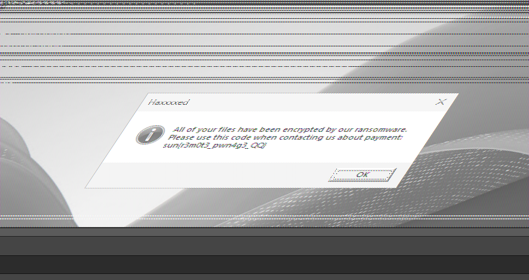

# Remotely Interesting

## Forensics (Medium)

## Solution

In the memory dump itself, there are no actual string representations of the flag, so players will not be able to just use strings or other tools to try find the flag in the dump. The key destinction is that this is a dump of dwm.exe, the Desktop Window Manager, which is likely to have a buffer of the screen image in its memory.

To find this image, players can use Gimp to import the dump file as data and then just have to manually adjust the offset, width, and height to attempt to align everything correctly to get a visible image.

Once they are successful, the players will be able to see an image of what was on the screen during the capture, including a dialog window with the flag.

