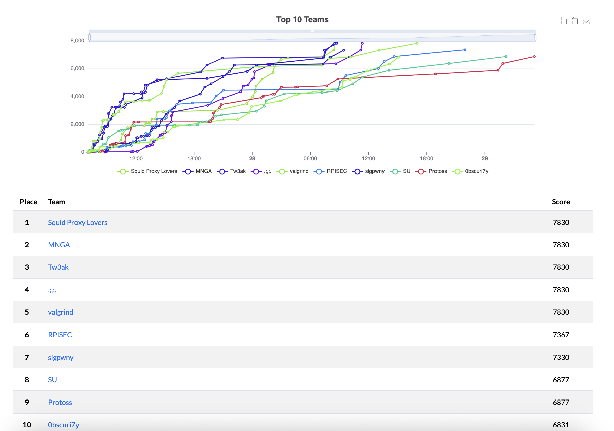
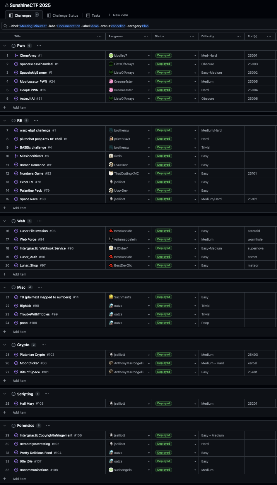

SunshineCTF 2025 Challenges
-----

This is the public release of the challenges from [SunshineCTF 2025](https://ctftime.org/event/2863).
Unless otherwise specified, all challenges are released under the MIT license.

### How to build/deploy Reversing and Pwn challenges

Install the `pwnmake` command by following the instructions located at https://github.com/C0deH4cker/PwnableHarness.

* To compile ~~all~~ _most_ binaries: `pwnmake`
* To build and run Docker contianers for all server-based challenges: `pwnmake docker-build`
* To publish all build artifacts that should be distributed to players into the `publish` folder: `pwnmake publish`

Each of these can be sped up by adding an argument like `-j8` to run it with 8
parallel workers.

### Challenge planning and organization

We used GitHub Projects again this year to keep track of our challenges. It is
an excellent way to see at a glance how many challenges in each category we had,
the difficulty levels of them, the development/testing status of each, and the
port numbers assigned to each challenge. This screenshot only shows some of the
challenges that actually made it to being used in the CTF.

### GitHub repo structuring

This year, we used a new strategy for managing our internal private repos. Historically,
we've always just used a single private repo that all authors have access to. This year,
due to having a bunch of new challenge authors, we decided to try out a new structure.
Specifically, each challenge was developed in a separate private repo, with this naming
convention: `<Year>-<Category>-<ChallengeName>`. Authors don't need to be skilled with
git, as they have their own repo to do what they want with and no merging to worry about.
Then, each category lead was tasked with integrating each challenge repo into the main
umbrella repo by using `git subrepo`. This ended up working pretty well, though we'd like
to automate this in the future with a Discord bot for setting up and managing challenge
repos.

We hope to soon migrate the challenges from this year's SunshineCTF competition
(and previous years) to a new, permanent home. More on this later!
